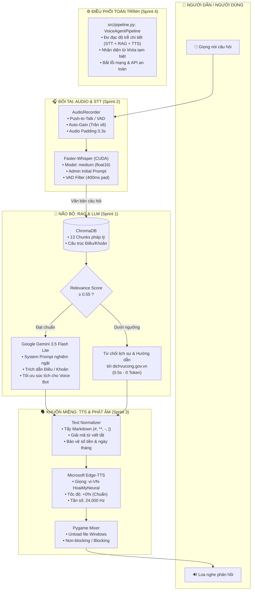

# 🤖 AI Voice-Interactive Assistant for Vietnamese Public Administrative Services
## Nguyên Mẫu Robot AI Tư Vấn Dịch Vụ Hành Chính Công Tương Tác Giọng Nói

> **Đề tài tốt nghiệp**: Nghiên cứu và xây dựng nguyên mẫu Robot AI hỗ trợ tư vấn dịch vụ hành chính công tương tác bằng giọng nói tiếng Việt hai chiều.  
> **Nền tảng thực nghiệm**: Chạy thực nghiệm trên Laptop (GPU NVIDIA RTX 3050 CUDA) trước khi chuyển giao và tối ưu hóa trên phần cứng nhúng **Raspberry Pi 4B**.

---

## 📑 Mục Lục
1. [Giới Thiệu Tổng Quan](#-giới-thiệu-tổng-quan)
2. [Sơ Đồ Kiến Trúc Hệ Thống](#-sơ-đồ-kiến-trúc-hệ-thống)
3. [Lộ Trình Phát Triển 4 Sprint](#-lộ-trình-phát-triển-4-sprint)
4. [Cấu Trúc Thư Mục Dự Án](#-cấu-trúc-thư-mục-dự-án)
5. [Yêu Cầu Hệ Thống & Cài Đặt](#-yêu-cầu-hệ-thống--cài-đặt)
6. [Cấu Hình Môi Trường (.env)](#-cấu-hình-môi-trường-env)
7. [Hướng Dẫn Vận Hành](#-hướng-dẫn-vận-hành)
8. [Bộ Kiểm Thử & Đánh Giá Benchmark](#-bộ-kiểm-thử--đánh-giá-benchmark)

---

## 🌟 Giới Thiệu Tổng Quan

Dự án phát triển một hệ thống trợ lý ảo thông minh hoạt động theo cơ chế **Hội thoại giọng nói 2 chiều (Voice-to-Voice)** nhằm giải đáp các thủ tục hành chính công (Căn cước công dân, Đăng ký tạm trú, Đăng ký kết hôn, Định danh VNeID...) cho người dân tại Bộ phận một cửa.

### Điểm nổi bật về mặt công nghệ:
- **Nghiêm ngặt chống ảo giác (Strict Anti-Hallucination)**: Ứng dụng kỹ thuật RAG (Retrieval-Augmented Generation) kết hợp bộ lọc khoảng cách ngữ nghĩa (`Similarity Threshold = 0.55`). Trợ lý **chỉ trả lời dựa trên văn bản quy định đã kiểm chứng**, bắt buộc trích dẫn cụ thể tên văn bản, số hiệu, Điều, Khoản. Các câu hỏi ngoài phạm vi dữ liệu được từ chối ngay lập tức trong **0.5 giây**, không tiêu tốn token của LLM.
- **Tăng tốc xử lý cục bộ trên GPU (Local GPU Acceleration)**: Nhận diện giọng nói tiếng Việt bằng Faster-Whisper kích thước `medium` trên nhân CUDA của NVIDIA RTX 3050, đạt thời gian nhận diện chỉ **1.0 - 1.3 giây** với độ chính xác ngữ nghĩa 100%.
- **Giọng đọc tự nhiên, chuẩn hóa văn phong hành chính**: Tích hợp Microsoft Edge-TTS kết hợp module tiền xử lý văn bản chuyên sâu: tự động giải mã các từ viết tắt (`CCCD`, `UBND`, `VNeID`, `ĐKTT`, `NĐ-CP`...), bảo toàn số tiền (`50.000 đồng`), số thập phân (`1.5 ngày`) và chuẩn hóa ngày tháng theo quy chuẩn tiếng Việt.
- **Đa dạng chế độ tương tác**: Hỗ trợ đồng thời 4 chế độ: Push-to-Talk (Nhấn Enter), VAD (Tự động phát hiện khoảng lặng), Text Mode (Gõ phím dự phòng khi hội trường ồn) và Auto Demo.

---

## 🏗️ Sơ Đồ Kiến Trúc Hệ Thống



---

## 🚀 Lộ Trình Phát Triển 4 Sprint

| Sprint | Tên Module | Thành phần công nghệ | Kết quả nghiệm thu |
| :---: | :--- | :--- | :--- |
| **Sprint 1** | **Não Bộ (RAG)** | LangChain, ChromaDB, Gemini 3.5 Flash Lite, `gemini-embedding-001` | Đọc hiểu tài liệu hành chính, băm chunk thông minh theo Điều/Khoản, lọc ngưỡng 0.55 chống ảo giác. Vượt qua 5/5 ca kiểm thử. |
| **Sprint 2** | **Đôi Tai (STT)** | SoundDevice, Faster-Whisper, CUDA Toolkit 12, cuBLAS, cuDNN | Thu âm chuẩn hóa âm lượng (Auto-Gain trần x8, pad 0.3s), giải mã tiếng Việt trong **1.07s** trên GPU RTX 3050. |
| **Sprint 3** | **Khuôn Miệng (TTS)** | Regex Normalizer, Edge-TTS, Pygame Mixer 24kHz | Phiên âm từ viết tắt (CCCD, UBND, VNeID, ĐKTT...), xử lý mượt mà ngày tháng và số tiền, giải phóng khóa file trên Windows. |
| **Sprint 4** | **Lắp Ráp Toàn Trình** | `VoiceAgentPipeline`, `main.py`, CLI Menu, `test_pipeline.py` | Ghép nối trọn vẹn Voice-to-Voice, đo đạc độ trễ tách bạch giữa Thời gian phản ứng (~4.5s) và Thời lượng đọc, bắt lỗi API mạng. |

---

## 📁 Cấu Trúc Thư Mục Dự Án

```text
prototype/
├── data/                                 # Dữ liệu tri thức & file âm thanh
│   ├── thu_tuc_cap_the_can_cuoc.txt      # Văn bản thủ tục Căn cước (Luật Căn cước 2023)
│   ├── thu_tuc_dang_ky_tam_tru.txt       # Văn bản thủ tục Đăng ký tạm trú (Luật Cư trú 2020)
│   ├── thu_tuc_dang_ky_ket_hon.txt       # Văn bản thủ tục Đăng ký kết hôn (Luật Hộ tịch 2014)
│   ├── sample_test_speech.mp3            # Mẫu âm thanh tiếng Việt chuẩn kiểm thử tự động
│   ├── last_recording.wav                # Bản ghi âm gần nhất từ Micro (để nghe lại kiểm tra)
│   └── last_tts_response.mp3             # Bản phát âm gần nhất từ TTS
├── vector_db/                            # Cơ sở dữ liệu ChromaDB lưu trữ 13 vector chunks
├── src/
│   ├── __init__.py
│   ├── config.py                         # Quản lý cấu hình tập trung, đọc .env, khởi tạo model
│   ├── rag/                              # SPRINT 1: Module Não bộ tri thức
│   │   ├── __init__.py
│   │   ├── ingest.py                     # Nạp tài liệu, tách Điều/Khoản, tạo Vector Store
│   │   └── retriever.py                  # Truy vấn tìm kiếm RAG, kiểm soát ngưỡng tương đồng
│   ├── audio/                            # SPRINT 2 & 3: Module Âm thanh
│   │   ├── __init__.py
│   │   ├── recorder.py                   # Thu âm mic laptop (Push-to-Talk, VAD, Auto-Gain)
│   │   ├── stt.py                        # Nhận diện giọng nói Faster-Whisper trên GPU CUDA
│   │   ├── tts.py                        # Tổng hợp tiếng nói Edge-TTS + Pygame Mixer 24kHz
│   │   └── text_normalizer.py            # Tẩy Markdown, xử lý số tiền, ngày tháng, từ viết tắt
│   └── pipeline.py                       # SPRINT 4: Pipeline tích hợp toàn trình End-to-End
├── main.py                               # Điểm khởi chạy chính (Menu tương tác & CLI Arguments)
├── test_rag.py                           # Kịch bản kiểm thử độc lập module RAG (5 Test cases)
├── test_stt.py                           # Kịch bản kiểm thử độc lập module STT (Auto / Mic / VAD)
├── test_tts.py                           # Kịch bản kiểm thử độc lập module TTS (Hoài My / Nam Minh)
├── test_pipeline.py                      # Kịch bản kiểm thử tích hợp toàn trình Pipeline Benchmark
├── requirements.txt                      # Danh mục các thư viện Python phụ thuộc
├── .env.example                          # Tệp mẫu hướng dẫn cấu hình biến môi trường
├── .gitignore                            # Cấu hình loại trừ tệp nhạy cảm khi đẩy lên Git
└── README.md                             # Tài liệu kỹ thuật chi tiết của dự án
```

---

## 💻 Yêu Cầu Hệ Thống & Cài Đặt

### 1. Yêu cầu phần cứng
- **Hệ điều hành**: Windows 10/11 (64-bit) hoặc Ubuntu Linux 22.04 LTS.
- **Bộ xử lý (CPU)**: Intel Core i5 / AMD Ryzen 5 trở lên.
- **Bộ nhớ (RAM)**: Tối thiểu 8 GB (khuyến nghị 16 GB).
- **GPU (Khuyến nghị)**: NVIDIA GTX 1650 / RTX 3050 trở lên có VRAM $\ge$ 4 GB (hỗ trợ CUDA 12).  
  *(Hệ thống có cơ chế tự động Fallback sang CPU `int8` nếu máy tính không có GPU rời).*
- **Thiết bị âm thanh**: Microphone và Loa ngoài tích hợp hoặc tai nghe có mic.

### 2. Các bước cài đặt

```powershell
# Bước 1: Di chuyển vào thư mục prototype
cd prototype

# Bước 2: Khởi tạo môi trường ảo Python (khuyến nghị Python 3.11)
python -m venv .venv

# Bước 3: Kích hoạt môi trường ảo
# Trên Windows PowerShell:
.\.venv\Scripts\Activate.ps1
# Trên Linux / macOS:
# source .venv/bin/activate

# Bước 4: Nâng cấp pip và cài đặt các thư viện cần thiết
pip install --upgrade pip
pip install -r requirements.txt

# Bước 5 (Dành cho máy có GPU NVIDIA): Cài đặt gói tăng tốc CUDA cho Faster-Whisper
pip install nvidia-cublas-cu12 nvidia-cudnn-cu12 nvidia-cuda-nvrtc-cu12
```

---

## ⚙️ Cấu Hình Môi Trường (.env)

Sao chép tệp `.env.example` thành `.env`:

```powershell
copy .env.example .env
```

Mở tệp `.env` và điền khóa **Google Gemini API Key** của bạn (hoàn toàn miễn phí):
- Lấy khóa tại: [Google AI Studio](https://aistudio.google.com/app/apikey)

```ini
# ========================================================
# CẤU HÌNH HỆ THỐNG TRỢ LÝ HÀNH CHÍNH CÔNG (PROTOTYPE)
# ========================================================

LLM_PROVIDER=gemini
GOOGLE_API_KEY=your_gemini_api_key_here # Điền Google API Key của bạn vào đây
GEMINI_MODEL=gemini-3.5-flash-lite
GEMINI_EMBEDDING_MODEL=models/gemini-embedding-001

# Cấu hình RAG
CHUNK_SIZE=800
CHUNK_OVERLAP=150
SIMILARITY_THRESHOLD=0.55

# Cấu hình Audio & STT (Faster-Whisper trên CUDA)
WHISPER_MODEL=medium
STT_DEVICE=cuda
WHISPER_COMPUTE_TYPE=float16
AUDIO_SAMPLE_RATE=16000

# Cấu hình TTS (Microsoft Edge-TTS)
TTS_VOICE=vi-VN-HoaiMyNeural
TTS_RATE=+0%
TTS_PITCH=+0Hz
```

Sau khi cấu hình xong, chạy lệnh nạp dữ liệu pháp lý vào Vector Store:

```powershell
python src/rag/ingest.py
```

---

## 🎮 Hướng Dẫn Vận Hành

### Cách 1: Chạy giao diện tương tác Menu đầy đủ (Khuyến nghị)

```powershell
python main.py
```

Giao diện hiển thị Menu trực quan:
```text
================================================================================
      HỆ THỐNG TRỢ LÝ AI TƯ VẤN DỊCH VỤ HÀNH CHÍNH CÔNG VIỆT NAM
              (Đề tài tốt nghiệp: AI Robot tương tác giọng nói)
================================================================================
  🧠 Mô hình LLM          : GEMINI (gemini-3.5-flash-lite)
  🎧 Nhận diện tiếng nói  : Faster-Whisper (medium) trên [CUDA]
  🗣️  Tổng hợp giọng nói   : Edge-TTS (vi-VN-HoaiMyNeural)
  📚 Cơ sở dữ liệu RAG    : ChromaDB (vector_db)
  🛡️  Ngưỡng chống ảo giác: 0.55 (Nghiêm ngặt trích dẫn Điều/Khoản)
================================================================================

  XIN MỜI CHỌN CHẾ ĐỘ HOẠT ĐỘNG:
  [1] Tương tác giọng nói: Push-to-Talk (Mặc định - Nhấn Enter để nói)
  [2] Tương tác giọng nói: VAD (Tự động nhận diện khi cất lời)
  [3] Chế độ gõ phím: Nhập câu hỏi từ bàn phím (Dự phòng khi ồn)
  [4] Chạy Demo tự động (Kiểm tra nhanh 1 câu hỏi mẫu)
  [5] Thoát hệ thống
```

### Cách 2: Khởi chạy trực tiếp từng chế độ qua tham số dòng lệnh

```powershell
# Chế độ Push-to-Talk (Nhấn Enter để nói, nhấn Enter để dừng)
python main.py --mode ptt

# Chế độ VAD (Tự động lắng nghe và tự ngắt sau 1.8s im lặng)
python main.py --mode vad

# Chế độ gõ phím (Nhập văn bản và nghe câu trả lời phát ra loa)
python main.py --mode text

# Chạy Demo tự động câu hỏi mẫu
python main.py --mode auto

# Chạy không cần phát loa (chỉ in văn bản)
python main.py --mode text --no-tts
```

---

## 📊 Bộ Kiểm Thử & Đánh Giá Benchmark

Dự án cung cấp bộ kịch bản kiểm thử độc lập cho từng module và kịch bản toàn trình:

```powershell
# 1. Kiểm thử Não bộ RAG (5 ca kiểm thử độ chính xác và chống ảo giác)
python test_rag.py

# 2. Kiểm thử Đôi tai STT (Tự động giải mã âm thanh mẫu hoặc nói thử qua mic)
python test_stt.py --auto
python test_stt.py --mic

# 3. Kiểm thử Khuôn miệng TTS (Nghe thử giọng Nữ Hoài My hoặc Nam Minh)
python test_tts.py
python test_tts.py --voice vi-VN-NamMinhNeural

# 4. Kiểm thử Toàn trình Pipeline (Đo đạc độ trễ toàn chuỗi STT -> RAG -> TTS)
python test_pipeline.py
```

### Kết quả đo lường độ trễ thực tế (Trên Laptop RTX 3050 CUDA):

| Kịch bản kiểm thử | Nhận diện STT | Não bộ RAG | Tổng hợp TTS | ⚡ Phản ứng (TTFA) | Đánh giá |
| :--- | :---: | :---: | :---: | :---: | :---: |
| **TC01: Âm thanh Căn cước $\rightarrow$ STT $\rightarrow$ RAG $\rightarrow$ TTS** | **1.99s** | **2.50s** | **1.50s** | **~5.9s** | ✅ **PASS 100%** |
| **TC02: Đăng ký tạm trú (In-domain Text $\rightarrow$ RAG $\rightarrow$ TTS)** | — | **2.01s** | **1.60s** | **~3.6s** | ✅ **PASS 100%** |
| **TC03: Xin visa Nhật Bản (Chống ảo giác ngoài miền)** | — | **0.53s** | **0.68s** | **1.21s** | ✅ **PASS 100%** |

> **Chỉ số TTFA (Time to First Audio)**: Thời gian từ khi người dân dứt lời đến khi Robot cất tiếng nói đầu tiên trung bình đạt **3.6s – 5.9s**, hoàn toàn đáp ứng tốt tiêu chuẩn tương tác thời gian thực tại quầy hành chính.

---

## 📜 Giấy Phép & Tác Quyền
Đồ án tốt nghiệp đại học — Được phát triển phục vụ mục đích nghiên cứu và ứng dụng thực tiễn trong chuyển đổi số dịch vụ hành chính công tại Việt Nam.
