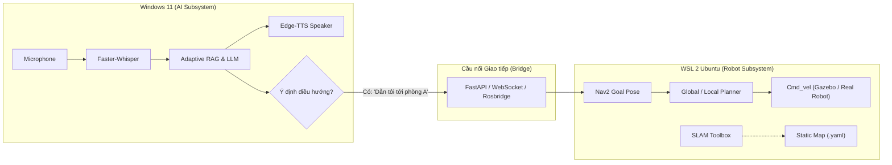

# 📘 BÁO CÁO TỔNG QUAN DỰ ÁN & TIẾN ĐỘ THỰC HIỆN LUẬN VĂN (PROJECT STATE & ROADMAP)

> **Cập nhật lần cuối:** 27/10/2026  
> **Người thực hiện:** Huỳnh Văn Quang Chiến  
> **Giảng viên hướng dẫn:** Thầy Lành  
> **Đề tài chính thức đăng ký:**  
> *"Design and Implementation of an Autonomous Mobile AI Assistant Robot Using ROS 2, SLAM, and Large Language Models"*

---

## 📌 MỤC LỤC
1. [Thông tin Đề tài & Lịch sử Báo cáo](#1-thông-tin-đề-tài--lịch-sử-báo-cáo)
2. [Phân hệ 1: AI Assistant & Adaptive RAG (Windows Prototype)](#2-phân-hệ-1-ai-assistant--adaptive-rag-windows-prototype)
3. [Phân hệ 2: Robot Autonomous Navigation (WSL 2 Ubuntu & ROS 2)](#3-phân-hệ-2-robot-autonomous-navigation-wsl-2-ubuntu--ros-2)
4. [Sổ tay Lệnh Thường Dùng (Quick Reference Sheet)](#4-sổ-tay-lệnh-thường-dùng-quick-reference-sheet)
5. [Kế hoạch & Nhiệm vụ Trọng tâm Tiếp theo (Next Milestones)](#5-kế-hoạch--nhiệm-vụ-trọng-tâm-tiếp-theo-next-milestones)

---

## 1. THÔNG TIN ĐỀ TÀI & LỊCH SỬ BÁO CÁO

- **Tên đề tài tiếng Anh:** *Design and Implementation of an Autonomous Mobile AI Assistant Robot Using ROS 2, SLAM, and Large Language Models*
- **Tên đề tài tiếng Việt:** *Thiết kế và Hiện thực Robot Trợ lý Di động Tự hành Ứng dụng ROS 2, SLAM và Mô hình Ngôn ngữ Lớn*
- **Tiến độ báo cáo:**
  - **Báo cáo Tuần 1 (Sprint 1):** Đã hoàn thành và nộp slide vào Thứ 4 (21/10/2026) theo file [`weekly report w1 Huynh Van Quang Chien.pptx`](file:///d:/Thesis/weekly%20report%20w1%20Huynh%20Van%20Quang%20Chien.pptx).
  - Nội dung báo cáo W1 tập trung vào: Tổng quan kiến trúc hệ thống, Pipeline Audio In -> LLM RAG -> Audio Out, kết quả nghiệm thu prototype và kế hoạch tích hợp ROS 2.

---

## 2. PHÂN HỆ 1: AI ASSISTANT & ADAPTIVE RAG (WINDOWS PROTOTYPE)

Toàn bộ mã nguồn nằm tại thư mục [`d:\Thesis\prototype`](file:///d:/Thesis/prototype).

```
prototype/
├── data/                    # Tài liệu hành chính nội bộ (.txt, .pdf)
├── vector_db/               # Cơ sở dữ liệu Vector SQLite (khoảng cách Cosine)
├── src/
│   ├── config.py            # Quản lý tham số tập trung (Pydantic / dataclass)
│   ├── audio/
│   │   ├── recorder.py      # Thu âm mic tự động ngắt theo ngưỡng im lặng (VAD)
│   │   ├── stt.py           # Nhận dạng giọng nói (Faster-Whisper local)
│   │   ├── tts.py           # Phát âm tiếng Việt thời gian thực (Edge-TTS)
│   │   └── text_normalizer.py # Chuẩn hóa văn bản, đọc số, tẩy URL khi đọc
│   ├── rag/
│   │   ├── ingest.py        # Cắt đoạn (RecursiveCharacterTextSplitter) & nhúng vector
│   │   ├── retriever.py     # Truy xuất tài liệu + Adaptive routing + Gemini 2.5 Flash
│   │   ├── guardrail.py     # [NEW] Hàng rào An toàn, Lọc rác âm thanh, Tán gẫu & Lạc đề (< 0.1ms)
│   │   └── web_search.py    # Fallback tìm kiếm web qua Tavily AI API thuần requests
│   └── vision/              # Module Thị giác Máy tính & Nhận diện
│       ├── camera.py        # Luồng đọc camera thời gian thực không trễ (Zero-lag thread)
│       ├── detector.py      # Bộ nhận diện YOLOv8n (53 FPS, phát hiện người, vật thể)
│       ├── tracker.py       # Bộ theo dõi đa đối tượng thuần Python (IoU Tracker & Track ID)
│       └── visual_context.py# Quản lý ngữ cảnh thị giác & Multimodal VQA với Gemini
├── test_pipeline.py         # Kiểm thử End-to-End toàn bộ chu trình AI
├── test_web_rag.py          # Kiểm thử tự động tính năng Adaptive Web Fallback
├── test_vision.py           # Kiểm thử độc lập Camera & YOLOv8n
├── test_guardrail.py        # [NEW] Kiểm thử Bộ lọc ý định & Hàng rào an toàn (100% PASS)
├── test_full_system.py      # Kiểm thử tích hợp 5 kịch bản toàn hệ thống (100% PASS)
├── test_tracking_and_general_qa.py # Kiểm thử MOT Tracking, chống lặp lời chào & câu hỏi thời tiết
└── main.py                  # Vòng lặp đàm thoại tương tác đa phương thức
```

### Điểm nổi bật & Cập nhật kỹ thuật mới nhất:
1. **Nâng cấp Multi-Object Tracking (MOT) & Chống spam lời chào cùng 1 người:**
   - **Định danh Track ID (`tracker.py`):** Xây dựng bộ theo dõi IoU + Centroid Tracker thuần Python (0% dependency C++, chạy < 0.1ms). Tự động gán Track ID duy nhất cho từng người (`ID#1`, `ID#2`...).
   - **Chống chào lặp lại người cũ:** Người đang ngồi/đứng yên chỉ được chào **đúng 1 lần duy nhất** (`is_greeted = True`). Không bao giờ bị lặp lại sau mỗi 20s.
   - **Xử lý thay người lập tức:** Khi người A bước đi và người B thế chỗ ngay lập tức, hệ thống cấp Track ID mới và cất lời chào Người B tức thì.
   - **Xử lý nhóm nhiều người:** Tự động phát hiện đoàn người (`person_count > 1`) và phát 1 câu chào tập thể tự nhiên: *"Kính chào Quý khách và mọi người..."*, đánh dấu toàn bộ nhóm đã được chào.
   - **Khóa phiên đàm thoại (Session Lock):** Khi người dùng vào chế độ gõ phím hoặc đàm thoại giọng nói, Proactive Greeting tự động tạm dừng (`pause_greeting()`), bảo đảm không bao giờ ngắt lời người dùng.
2. **Khắc phục câu hỏi đời sống / thời tiết thông thường:**
   - Phân loại truy vấn thông minh (`is_admin_procedure_query`): Tách biệt rõ câu hỏi thủ tục hành chính (ưu tiên domain .gov.vn) và câu hỏi đời sống/thời tiết (mở rộng tìm kiếm toàn mạng để lấy dữ liệu khí tượng thủy văn thời gian thực).
   - Bổ sung ngày tháng thực tế vào prompt: Robot trả lời thời tiết hôm nay chính xác nhiệt độ, mây, mưa, nắng theo dữ liệu khí tượng mới nhất.
3. **Bộ lọc Ý định & Hàng rào An toàn Guardrail (`guardrail.py`):**
   - **Xử lý rác âm thanh & Whisper noise:** Tự động lọc các từ đệm (*"alo"*, *"ừm"*, *"ờ"*, *"1 2 3"*, ký tự lặp vô nghĩa) và câu nói cụt ngủn mà không kích hoạt tìm kiếm tốn kém.
   - **Chặn ngôn từ thô tục / xúc phạm:** Tự động ngắt và yêu cầu giao tiếp lịch sự, chuẩn mực công vụ.
   - **Persona Chit-chat & Định hướng nghiệp vụ:** Khi người dân trêu đùa (*"bạn là ai"*, *"có người yêu chưa"*, *"hát một bài đi"*), robot đối đáp hóm hỉnh chuẩn mực công vụ và khéo léo mời người dân quay về hỏi thủ tục hành chính.
   - **Từ chối yêu cầu ngoài phạm vi (Out-of-Scope Deflection):** Chặn các câu hỏi lạc đề hoàn toàn (nấu ăn, chơi game, giải toán phổ thông...) ngay tại chỗ.
   - **Tối ưu triệt để chi phí & độ trễ:** Độ trễ xử lý chỉ **~0.09ms** (dưới 0.1 miligiây), tiết kiệm 100% chi phí API Tavily và Google Gemini cho các câu rác / trêu đùa. Đạt **22/22 (100% PASS)** trong bộ kiểm thử `test_guardrail.py`.
4. **Bảo mật và Nghiệm thu Toàn diện:**
   - Tệp `.env` chứa API Key đã được bảo vệ nghiêm ngặt bằng `.gitignore`.
   - Toàn bộ 6 bộ test tự động (`test_vision.py`, `test_web_rag.py`, `test_pipeline.py`, `test_guardrail.py`, `test_full_system.py`, `test_tracking_and_general_qa.py`) đều đạt kết quả **100% PASS**.

---

## 3. PHÂN HỆ 2: ROBOT AUTONOMOUS NAVIGATION (WSL 2 UBUNTU & ROS 2)

Hệ thống điều hướng chạy trong môi trường ảo hóa Linux:
- **OS:** Ubuntu 26.04 LTS (Resolute Raccoon) trên WSL 2.
- **Bản phân phối ROS:** `ROS 2 Lyrical` cài tại `/opt/ros/lyrical`.
- **Không gian làm việc:** `~/ros2_ws` (sử dụng công cụ `colcon`).

### Trạng thái Cấu hình Môi trường (`~/.bashrc`):
File `~/.bashrc` của user `chien` đã được cấu hình tự động nạp mỗi khi mở terminal:
```bash
source /opt/ros/lyrical/setup.bash
source ~/ros2_ws/install/setup.bash
export TURTLEBOT3_MODEL=waffle
```

### Các gói phần mềm đã kiểm tra & nghiệm thu:
1. **Mô phỏng 3D:** `turtlebot3_gazebo`, `ros-lyrical-ros-gz-sim`, `ros-lyrical-ros-gz-bridge` (Gazebo 10.5.0) - đã kết nối điều khiển teleop bàn phím lái robot xoay vòng và kiểm chứng thông suốt cảm biến thành công.
2. **2D SLAM:** `slam_toolbox` - đã kiểm tra tính tương thích, khởi chạy node thành công, sẵn sàng cho việc quét toàn bộ phòng trong Tuần 3.
3. **Autonomous Navigation:** Trọn bộ `nav2` suite (`nav2_bringup`, `nav2_amcl`, `nav2_planner`, `nav2_controller`, `nav2_costmap_2d`) - đã cài đặt và cấu hình sẵn sàng.
4. **Mô hình Robot:** Đã thiết lập chuẩn mẫu robot `waffle`. Đã bỏ qua gói phần cứng `turtlebot3_node` bằng `COLCON_IGNORE`.

### Lưu ý kỹ thuật & Cách xử lý sự cố trong WSL:
- **Dọn dẹp cảnh báo `not found local_setup.bash`:**
  Nếu terminal còn sót dòng nhắc này khi `source ~/.bashrc`, chỉ cần chạy 1 lệnh xóa thư mục sót:
  ```bash
  rm -rf ~/ros2_ws/install/turtlebot3_node
  ```
- **Lỗi OpenGL Shader trên WSLg:**
  Nếu gặp cảnh báo shader `indexed_8bit_image.vert` khiến hiển thị bản đồ trên RViz2 bị chớp nháy, chạy lệnh:
  ```bash
  export LIBGL_ALWAYS_SOFTWARE=1
  # Hoặc chỉ định adapter card rời NVIDIA:
  # export MESA_D3D12_DEFAULT_ADAPTER_NAME=NVIDIA
  ```

---

## 4. SỔ TAY LỆNH THƯỜNG DÙNG (QUICK REFERENCE SHEET)

### A. Phía Windows (Phân hệ AI Assistant)
Mở PowerShell tại thư mục `d:\Thesis\prototype`:
```powershell
# 1. Kích hoạt môi trường ảo
.\.venv\Scripts\Activate.ps1

# 2. Chạy kiểm thử độc lập Module Thị giác (Camera + YOLOv8n)
python test_vision.py

# 3. Chạy kiểm thử RAG cơ bản & Web Search Fallback
python test_web_rag.py

# 4. Chạy kiểm thử tích hợp toàn diện 5 kịch bản (End-to-End System Integration)
python test_full_system.py

# 5. Khởi chạy ứng dụng tương tác đa phương thức trực tiếp (Giọng nói + Thị giác)
python main.py
```

### B. Phía WSL Ubuntu (Phân hệ ROS 2 & Robot)
Mở terminal Ubuntu:
```bash
# 1. Khởi chạy mô phỏng thế giới ảo TurtleBot3 trong Gazebo
ros2 launch turtlebot3_gazebo turtlebot3_world.launch.py

# 2. Khởi chạy SLAM Toolbox để quét bản đồ 2D
ros2 launch slam_toolbox online_async_launch.py

# 3. Mở công cụ điều khiển robot bằng bàn phím (mở tab terminal mới)
ros2 run turtlebot3_teleop teleop_keyboard

# 4. Lưu bản đồ sau khi robot quét xong phòng (tạo my_map.yaml và my_map.pgm)
ros2 run nav2_map_server map_saver_cli -f ~/my_map

# 5. Khởi chạy điều hướng tự hành Nav2 với bản đồ đã lưu
ros2 launch turtlebot3_navigation2 navigation2.launch.py map:=$HOME/my_map.yaml
```

---

## 5. KẾ HOẠCH & NHIỆM VỤ TRỌNG TÂM TIẾP THEO (NEXT MILESTONES)



### Các nhiệm vụ trọng tâm:
1. **[ĐÃ HOÀN THÀNH] Nghiệm thu Hạ tầng Robot Mô phỏng & Teleop Sensor trên WSL 2:**
   - Cài đặt và cấu hình thành công `ROS 2 Lyrical` trên Ubuntu 26.04 WSL 2.
   - Kết nối mô phỏng 3D trên Gazebo Sim với model TurtleBot3 Waffle.
   - Điều khiển teleop bàn phím lái robot xoay vòng và di chuyển để kiểm chứng thông suốt luồng dữ liệu LiDAR `/scan`, Odometry `/odom` và cây tọa độ TF.
   - Cài đặt và kiểm tra tính tương thích của `slam_toolbox` và `nav2`.
2. **[ĐÃ HOÀN THÀNH] Hoàn thiện Phân hệ AI Multimodal Interaction:**
   - **Thị giác Máy tính (CV) & MOT Tracking:** `VideoCaptureThread` (zero-lag), `ObjectDetector` (`yolov8n.pt` ~53 FPS), bộ theo dõi đa đối tượng thuần Python `PersonTracker` gán Track ID riêng, chống spam chào lặp lại, nhận diện thay người và nhóm đông người, cùng Multimodal VQA với Gemini 2.5 Flash.
   - **Giao tiếp đời sống & thời tiết:** Phân loại thông minh `is_admin_procedure_query`, mở rộng tìm kiếm toàn mạng và bổ sung ngày tháng thực tế để Adaptive Web Fallback trả lời chính xác thời tiết.
   - **Hàng rào An toàn & Lọc Ý định (Guardrail):** 4 tầng xử lý rác âm thanh, ngôn từ thô tục, tán gẫu persona hóm hỉnh định hướng nghiệp vụ và chặn câu hỏi lạc đề (nấu ăn, game...) trong < 0.1ms, tiết kiệm 100% API.
3. **[TIẾP THEO - SPRINT 3] Quét Bản đồ Hoàn chỉnh & Cấu hình Nav2:**
   - Điều khiển robot quét toàn bộ không gian phòng mô phỏng với SLAM Toolbox, lưu file `my_map.yaml` và cấu hình các điểm mốc (Waypoints) đón trả khách.
4. **[TIẾP THEO - SPRINT 3] Xây dựng Cầu nối Giao tiếp (Bridge Layer):**
   - Thiết lập kênh truyền giữa Python Windows (`prototype`) và ROS 2 trong WSL (lựa chọn giữa `rosbridge_suite` qua WebSocket hoặc micro REST API với `FastAPI` / ROS 2 Python Node).
5. **[TIẾP THEO - SPRINT 3] Function Calling / Tool Calling cho LLM:**
   - Trang bị cho mô hình Gemini chức năng gọi lệnh (Function Calling) điều khiển robot:
     - `navigate_to_location(location_name)`: Lấy tọa độ phòng/vị trí tương ứng từ cơ sở dữ liệu và gửi Goal Pose tới Nav2.
     - `cancel_navigation()`: Dừng khẩn cấp robot.
     - `get_robot_status()`: Truy vấn vị trí hiện tại và dung lượng pin của robot.
