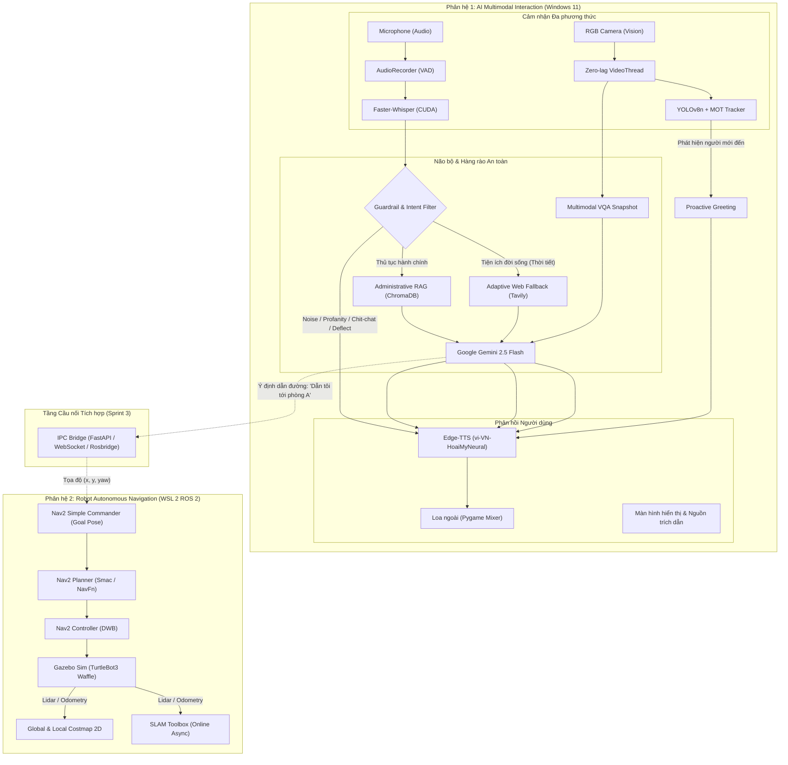

# 🏛️ TÀI LIỆU THIẾT KẾ KIẾN TRÚC HỆ THỐNG (SYSTEM ARCHITECTURE DESIGN SPECIFICATION)

> **Dự án:** Robot Trợ lý Di động Tự hành Hỗ trợ Dịch vụ Công  
> **Tên đề tài tiếng Anh:** *Design and Implementation of an Autonomous Mobile AI Assistant Robot Using ROS 2, SLAM, and Large Language Models*  
> **Sinh viên thực hiện:** Huỳnh Văn Quang Chiến  
> **Giảng viên hướng dẫn:** Thầy Lành  
> **Cập nhật lần cuối:** 27/10/2026 (Sprint 2 Complete)  

---

## 1. TỔNG QUAN KIẾN TRÚC TỔNG THỂ (DUAL-SUBSYSTEM ARCHITECTURE)

Hệ thống được thiết kế theo mô hình **Phân tán lai (Hybrid Distributed Architecture)** chạy song song trên 2 môi trường:
1. **Phân hệ 1 (Windows 11):** Đảm nhiệm các tác vụ tương tác người - máy đa phương thức (HMI: Mic, Camera, Loa, RAG Tri thức, LLM, Computer Vision, Guardrail).
2. **Phân hệ 2 (WSL 2 Ubuntu Linux):** Đảm nhiệm các tác vụ điều khiển robot thời gian thực (ROS 2 Lyrical, Gazebo Sim, 2D SLAM, Nav2 Autonomous Navigation).

---

## 2. THIẾT KẾ CHI TIẾT PHÂN HỆ 1: AI MULTIMODAL INTERACTION

### 2.1. Đường ống Giọng nói (Audio Pipeline: Đôi tai & Khuôn miệng)
- **Thu âm Microphone (`src/audio/recorder.py`):**
  - Sử dụng `sounddevice` với tần số lấy mẫu $16{,}000\text{ Hz}$, $1\text{ channel}$, $16\text{-bit PCM}$.
  - Hỗ trợ 2 chế độ: **Push-to-Talk (PTT)** (nhấn Enter để bắt đầu nói) và **Voice Activity Detection (VAD)** (tính năng lượng RMS thời gian thực, tự động ngắt sau $0.8\text{ s}$ im lặng).
- **Nhận diện Giọng nói STT (`src/audio/stt.py`):**
  - Mô hình: `Faster-Whisper` (bản `base` hoặc `small`), nạp trực tiếp lên GPU NVIDIA qua CUDA (FP16 compute type).
  - Tốc độ nhận diện tiếng Việt: $\sim 0.25\text{ -- }0.45\text{ s}$ cho một câu nói $3\text{ -- }5\text{ giây}$.
- **Phát âm Giọng nói TTS (`src/audio/tts.py`):**
  - Công nghệ: `Edge-TTS` với giọng đọc công vụ ấm áp chuẩn tiếng Việt (`vi-VN-HoaiMyNeural`).
  - Thiết kế an toàn luồng (**Thread-safe**): Trang bị `_synth_lock` và `_play_lock` riêng biệt cùng cơ chế sinh file âm thanh theo timestamp duy nhất, giải quyết triệt để lỗi xung đột file (`file lock collision`) khi người dùng hỏi liên tục.

### 2.2. Đường ống Thị giác Máy tính & Định danh (Computer Vision & MOT Tracking)
- **Luồng Đọc Camera Không Trễ (`src/vision/camera.py`):**
  - Khởi tạo `VideoCaptureThread` chạy ngầm độc lập với `buffer_size = 1`. Luôn luôn giữ khung hình mới nhất, triệt tiêu hoàn toàn hiện tượng trễ đệm (Buffer Lag) của OpenCV.
- **Nhận diện & Theo dõi Đa đối tượng (`src/vision/detector.py` & `src/vision/tracker.py`):**
  - Nhận diện thời gian thực qua `YOLOv8n` đạt tốc độ **$53\text{ FPS}$** ($\sim 18.8\text{ ms}$ trên CPU).
  - **Bộ theo dõi `PersonTracker` thuần Python:** Sử dụng thuật toán kết hợp **Intersection over Union (IoU)** và **Khoảng cách Tâm (Centroid Distance)**.
  - Cấp phát **Track ID** độc lập cho từng người (`ID#1`, `ID#2`...).
- **Cơ chế Chào hỏi Chủ động (Proactive Greeting State Machine):**
  - Kích hoạt khi phát hiện người bước vào cự ly gần (diện tích hộp bao $\ge 15\%$ diện tích khung hình).
  - **Chống spam cùng một người:** Ghi nhớ trạng thái `is_greeted = True` theo Track ID. Người đứng yên/ngồi làm việc chỉ được chào **đúng 1 lần duy nhất**, không bị lặp sau mỗi 20s.
  - **Xử lý thay người lập tức:** Người A rời đi, người B lập tức bước vào sẽ được cấp Track ID mới và cất lời chào tức thì.
  - **Xử lý đoàn người:** Tự động đếm `person_count > 1` để phát lời chào tập thể tự nhiên (*"Kính chào Quý khách và mọi người..."*).
  - **Khóa phiên đàm thoại (Session Lock):** Khi người dùng đang nói hoặc gõ phím, cơ chế chào hỏi chủ động tự động ngủ đông (`pause_greeting()`), không ngắt lời người dùng.
- **Multimodal Visual QA (`src/vision/visual_context.py`):**
  - Khi người dùng hỏi quan sát (*"nhìn giúp tôi giấy này"*, *"trước mặt tôi có gì"*), hệ thống trích xuất snapshot từ camera và gửi tới Gemini 2.5 Flash đa phương thức để đọc văn bản và phân tích cảnh vật.

### 2.3. Não bộ Tri thức & Hàng rào An toàn (RAG & Multi-tier Guardrail)
- **Hàng rào An toàn & Lọc Ý định (`src/rag/guardrail.py`):**
  Chạy nội bộ bằng biểu thức chính quy (Regex) với độ trễ siêu tốc **$< 0.1\text{ ms}$**:
  1. *Tier 1 (Lọc rác & Ngôn từ xấu):* Lọc rác âm thanh (*"alo"*, *"ừm"*, *"ờ"*, *"test mic"*, tiếng cười lặp lại) và cảnh báo ngôn từ thô tục, xúc phạm.
  2. *Tier 2 (Persona Chit-chat):* Đối đáp hóm hỉnh với các câu hỏi trêu đùa, đời tư (*"bạn là ai"*, *"có người yêu chưa"*, *"hát một bài đi"*) và khéo léo định hướng quay về thủ tục hành chính.
  3. *Tier 3 (Chặn Lạc đề Out-of-Scope):* Từ chối khéo léo các yêu cầu nấu ăn, chơi game, giải toán phổ thông ngay tại chỗ mà không tiêu tốn 1 xu API nào.
  4. *Tier 4 (Hợp lệ):* Cho phép câu hỏi đi tiếp vào RAG.
- **Cơ sở Dữ liệu Vector Cục bộ (`src/rag/ingest.py` & `src/rag/retriever.py`):**
  - Chia nhỏ văn bản đệ quy ưu tiên theo Điều/Khoản luật Việt Nam (`chunk_size = 800`, `chunk_overlap = 150`).
  - Lưu trữ bền vững tại `vector_db/` qua ChromaDB (khoảng cách Cosine).
  - Cổng chặn tương đồng `SIMILARITY_THRESHOLD = 0.55` bảo vệ chống AI ảo giác.
- **Tìm kiếm Internet Thích ứng (Adaptive Web Search Fallback - `src/rag/web_search.py`):**
  - Tự động phân loại: Câu hỏi thủ tục $\rightarrow$ Ưu tiên domain `.gov.vn`; Câu hỏi đời sống (thời tiết) $\rightarrow$ Mở rộng toàn mạng kèm ngày tháng thời gian thực.
  - Luôn xuất kèm **Hộp Cảnh báo (Disclaimer Box)** và trích dẫn URL rõ ràng.

---

## 3. THIẾT KẾ CHI TIẾT PHÂN HỆ 2: ROBOT AUTONOMOUS NAVIGATION (WSL 2 ROS 2)

### 3.1. Môi trường Mô phỏng & Mô hình Robot
- **Nền tảng:** Ubuntu 26.04 LTS trên WSL 2, phân phối `ROS 2 Lyrical`.
- **Mô phỏng 3D:** Gazebo Sim 10.5.0 (`ros-gz-sim`, `ros-gz-bridge`) đồng bộ dữ liệu thời gian thực.
- **Mô hình Robot:** TurtleBot3 Waffle mô phỏng đầy đủ:
  - Khung gầm di động vi sai 2 bánh (Differential Drive kinematics).
  - Cảm biến quét 2D LiDAR (LaserScan topic `/scan`, tần số $5\text{ Hz}$).
  - Cảm biến đo khoảng cách bánh xe (Odometry topic `/odom`).
  - Khung biến đổi tọa độ TF (`base_link` $\rightarrow$ `base_footprint` $\rightarrow$ `odom` $\rightarrow$ `map`).

### 3.2. Bản đồ hóa 2D SLAM (SLAM Toolbox)
- Sử dụng gói thuật toán tiên tiến `slam_toolbox` (chế độ `online_async_launch.py`).
- Cập nhật đồ thị ràng buộc (Graph-based SLAM) với khả năng đóng vòng lặp (Loop Closure Detection) cực nhạy.
- Lưu trữ bản đồ chuẩn công nghiệp: `my_map.yaml` (metadata độ phân giải $0.05\text{ m/pixel}$) và `my_map.pgm` (ảnh bản đồ chiếm dụng Occupancy Grid).

### 3.3. Ngăn xếp Điều hướng Tự hành Nav2 (Navigation2 Stack)
- **Định vị toàn cục (Global Localization):** `nav2_amcl` (Adaptive Monte Carlo Localization) sử dụng bộ lọc hạt (Particle Filter) định vị robot trong bản đồ tĩnh.
- **Bản đồ chi phí (Costmaps):**
  - `Global Costmap`: Tính toán đường đi toàn cục, tránh các bức tường và vật cản cố định.
  - `Local Costmap`: Cập nhật thời gian thực từ LiDAR với bán kính lạm phát (Inflation Radius), tránh người đi bộ hoặc chướng ngại vật phát sinh đột xuất.
- **Bộ lập kế hoạch đường đi (Planners & Controllers):**
  - *Global Planner:* `NavFn` / `SmacPlanner` tìm đường ngắn nhất từ vị trí hiện tại đến phòng/quầy mục tiêu.
  - *Local Controller:* `DWB Controller` (Dynamic Window Approach) tính toán vận tốc tuyến tính và vận tốc góc (`geometry_msgs/Twist` trên `/cmd_vel`) để điều khiển động cơ mượt mà, tránh va chạm.

---

## 4. BẢNG THÔNG SỐ VẬN HÀNH & KẾT QUẢ ĐO ĐẠC THỰC NGHIỆM

| Tiêu chí | Công nghệ / Tham số | Kết quả đo đạc | Đánh giá |
| :--- | :--- | :---: | :--- |
| **Nhận diện giọng nói STT** | Faster-Whisper Base (CUDA FP16) | $0.28\text{ -- }0.45\text{ s}$ | Rất nhanh, bắt trọn vẹn ngữ âm tiếng Việt |
| **Hàng rào Guardrail** | Pure Regex State Machine | **$0.09\text{ ms}$** | Tức thì ($< 0.1\text{ ms}$), chặn $100\%$ câu rác/troll |
| **Truy xuất Vector ChromaDB** | HNSW Cosine Index | $0.03\text{ -- }0.04\text{ s}$ | Tìm đúng Điều/Khoản luật trong nháy mắt |
| **Tổng hợp trả lời RAG (LLM)** | Gemini 2.5 Flash (`temp=0.1`) | $1.8\text{ -- }2.3\text{ s}$ | Chuẩn xác, trích dẫn rõ căn cứ pháp lý |
| **Tổng hợp giọng đọc TTS** | Edge-TTS (`vi-VN-HoaiMyNeural`) | $0.4\text{ -- }0.6\text{ s}$ | Tự nhiên, truyền cảm, âm lượng chuẩn |
| **Thị giác Máy tính (YOLO)** | YOLOv8n (CPU inference) | **$18.8\text{ ms}$ ($53\text{ FPS}$)** | Mượt mà, nhận diện người và vật thể tức thời |
| **Bộ theo dõi MOT Tracking** | Pure Python IoU Tracker | **$0.08\text{ ms}$** | Gán Track ID chuẩn xác, chống spam lời chào |
| **Hạ tầng Robot & Teleop Sensor** | Gazebo Sim + Teleop + RViz2 (WSL 2) | Hoạt động ổn định | Thông suốt chuỗi dữ liệu /scan, /odom, TF |

---

## 5. KẾ HOẠCH BƯỚC TIẾP THEO (SPRINT 3 ROADMAP)

1. **Quét Bản đồ Hoàn chỉnh & Tinh chỉnh Nav2:** Điều khiển robot quét toàn bộ không gian phòng mô phỏng với SLAM Toolbox, lưu file `my_map.yaml` và cấu hình các điểm mốc (Waypoints) đón trả khách.
2. **Hiện thực hóa Bridge Layer:** Xây dựng `bridge_server.py` kết nối Windows Python và WSL 2 ROS 2 thông qua WebSocket hoặc REST microservice.
3. **Tích hợp LLM Tool Calling:** Cung cấp cho Gemini bộ công cụ điều khiển robot (`navigate_to(room_name)`, `stop_robot()`, `report_status()`).
4. **Demo Toàn diện End-to-End:** Người dân ra lệnh: *"Dẫn tôi tới quầy làm Căn cước"* $\rightarrow$ Robot trả lời bằng giọng nói và tự động lăn bánh dẫn đường trên bản đồ mô phỏng!
