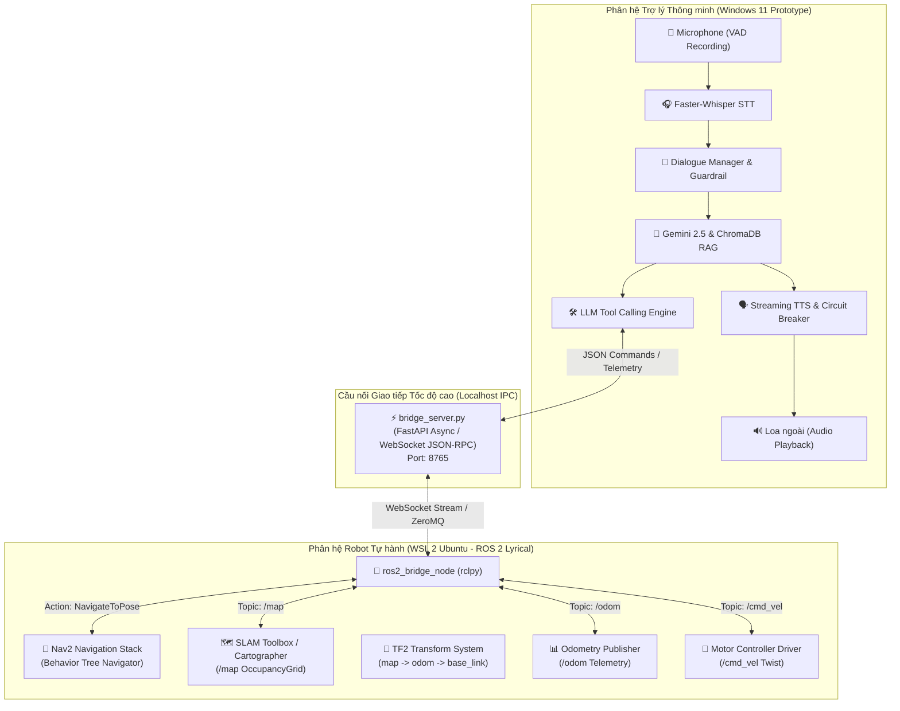

# 🤖 ĐẶC TẢ GIAO DIỆN TÍCH HỢP HỆ THỐNG ROBOT ROS 2 VÀ TRỢ LÝ THOẠI (TASK 5)

> **Thực hiện theo chỉ đạo của GVHD:** TS. Lê Thanh Lành (Tuần 4 - Sprint 4)  
> **Nhiệm vụ:**  
> - Làm rõ cơ chế giao tiếp liên tiến trình (IPC) giữa Phân hệ Trợ lý Thoại (Windows AI) và Phân hệ Điều khiển Robot (ROS 2 trên WSL 2).  
> - Định nghĩa tường minh các giao diện (Interfaces) giữa Tương tác Thoại, Điều hướng (Navigation Nav2) và Lập bản đồ (SLAM).  
> - Cung cấp sơ đồ kiến trúc tổng thể nâng cấp và lộ trình tích hợp thực tế cho các tuần kế tiếp.

---

## 1. MÔ HÌNH TRUYỀN THÔNG LIÊN TIẾN TRÌNH IPC (WINDOWS AI <-> WSL 2 ROS 2)

Hệ thống được tổ chức theo kiến trúc **Heterogeneous Multi-OS Bridge (Cầu nối Đa hệ điều hành Lai)**:
- **Phía Windows 11 (AI Subsystem):** Tận dụng tối đa phần cứng GPU NVIDIA RTX, driver âm thanh chuẩn DirectX/WASAPI (Microphone đa hướng & Loa), thư viện Faster-Whisper và Pygame mixer.
- **Phía WSL 2 Ubuntu (Robotics Subsystem):** Chạy nền tảng ROS 2 Lyrical, SLAM Toolbox, Nav2 Stack và các node điều khiển động cơ vi điều khiển (Micro-ROS / Serial).



---

## 2. ĐỊNH NGHĨA CHI TIẾT CÁC GIAO DIỆN (INTERFACE SPECIFICATIONS)

### 2.1. Giao diện Tương tác Thoại -> Điều hướng tự hành (Voice to Nav2)

Khi công dân đặt câu hỏi liên quan đến chỉ đường hoặc yêu cầu dẫn đường (ví dụ: *"Dẫn tôi tới phòng Tiếp nhận Một cửa"*), Não bộ Gemini thông qua **LLM Tool Calling** sẽ kích hoạt hàm điều hướng:

- **Hành động ROS 2 (ROS 2 Action):** `/navigate_to_pose`
- **Kiểu thông điệp (Action Type):** `nav2_msgs/action/NavigateToPose`
- **Cấu trúc dữ liệu mục tiêu (Goal Payload):**
```json
{
  "action": "navigate_to_location",
  "target_name": "phong_mot_cua",
  "pose": {
    "header": {
      "frame_id": "map",
      "stamp": { "sec": 1731139200, "nanosec": 0 }
    },
    "pose": {
      "position": { "x": 12.45, "y": 8.30, "z": 0.0 },
      "orientation": { "x": 0.0, "y": 0.0, "z": 0.707, "w": 0.707 }
    }
  }
}
```
- **Phản hồi thời gian thực (Action Feedback):**
  - Cập nhật tọa độ hiện tại của robot: `current_pose`.
  - Khoảng cách còn lại tới đích: `distance_remaining` (mét).
  - Thời gian di chuyển dự kiến: `estimated_time_remaining` (giây).
  - Trợ lý giọng nói tận dụng thông tin này để thông báo: *"Dạ, còn khoảng 5 mét nữa là tới nơi ạ."*

---

### 2.2. Giao diện Tương tác Thoại -> Bản đồ và SLAM (Voice to SLAM & Mapping)

- **Chủ đề bản đồ tĩnh (Topic):** `/map`
- **Kiểu thông điệp:** `nav_msgs/msg/OccupancyGrid`
- **Chức năng:**
  - Cung cấp dữ liệu lưới không gian 2D (Occupancy Grid: 0 = trống, 100 = vật cản, -1 = chưa khám phá).
  - Trợ lý AI nạp danh sách các **Tọa độ địa danh đặc trưng (Semantic Waypoints)** được gán nhãn trong bản đồ:
    - `phong_mot_cua`: (X=12.45, Y=8.30)
    - `ban_huong_dan`: (X=2.10, Y=1.50)
    - `phong_cong_chung`: (X=8.70, Y=15.20)
    - `tram_sac_pin`: (X=0.00, Y=0.00)

---

### 2.3. Giao diện Trạng thái Robot -> Bù trừ Thị giác & Hội thoại (Telemetry to Voice & Vision)

- **Vận tốc và Gia tốc robot (Topic):** `/odom`
- **Kiểu thông điệp:** `nav_msgs/msg/Odometry`
- **Ứng dụng đột phá:**
  - **Bù trừ vận tốc góc cho camera (Điểm nghẽn 4):** Trích xuất vận tốc góc $\omega_z$ đưa vào bộ lọc Kalman của `PersonTracker` (MOT), giúp camera không bị mất dấu người dùng khi khung gầm robot quay đầu đổi hướng.
- **Trạng thái Nguồn điện (Topic):** `/battery_state`
- **Kiểu thông điệp:** `sensor_msgs/msg/BatteryState`
- **Ứng dụng:**
  - Tự động cảnh báo bằng giọng nói khi dung lượng pin $< 20\%$: *"Dạ, mức pin của em hiện dưới 20%, em xin phép tạm dừng để quay về trạm sạc tự động ạ."*

---

### 2.4. Giao diện Lệnh khẩn cấp dừng tức thì (Safety Emergency Stop)

- **Chủ đề điều khiển vận tốc (Topic):** `/cmd_vel`
- **Kiểu thông điệp:** `geometry_msgs/msg/Twist`
- **Hành vi:**
  - Khi người dùng nói các từ khóa khẩn cấp: *"Dừng lại"*, *"Đứng yên"*, *"Khoan đã"*.
  - Module Voice Agent phát lệnh khẩn cấp qua IPC Bridge:
```json
{
  "command": "emergency_stop",
  "twist": {
    "linear": { "x": 0.0, "y": 0.0, "z": 0.0 },
    "angular": { "x": 0.0, "y": 0.0, "z": 0.0 }
  }
}
```
  - Robot phanh dừng lập tức trong $< 50\text{ ms}$, triệt tiêu nguy cơ va chạm.

---

## 3. LỘ TRÌNH TÍCH HỢP TOÀN DIỆN CÁC TUẦN TIẾP THEO

| Tuần thực hiện | Hạng mục trọng tâm | Mục tiêu nghiệm thu |
|:---:|---|---|
| **Tuần 4 (Hiện tại)** | Thẩm định thực nghiệm Streaming TTS, Circuit Breaker & Đặc tả ROS 2 IPC. | Hoàn thành 100% 5 yêu cầu của GVHD TS. Lê Thanh Lành (Báo cáo, Biểu đồ, Mã nguồn). |
| **Tuần 5** | Triển khai `bridge_server.py` & Kết nối Nav2 Simulation (Gazebo / TurtleBot3). | Robot nhận lệnh thoại trên Windows và tự động điều hướng tới Waypoint chỉ định trong môi trường ảo. |
| **Tuần 6** | Tích hợp phần cứng thực tế (Khung gầm vi điều khiển STM32 + Lidar RPLidar + Camera USB). | Robot chạy thực tế tại sảnh cơ quan, vừa di chuyển vừa giải đáp thủ tục hành chính công. |
| **Tuần 7** | Tối ưu hóa toàn diện độ trễ Token-to-Speech Streaming (< 0.6s) & Hoàn thiện Luận văn. | Nghiệm thu toàn trình hệ thống, viết báo cáo tốt nghiệp chính thức. |
