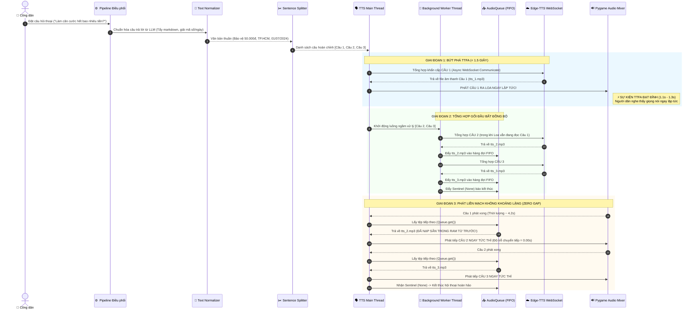

# 🎬 TÀI LIỆU MINH CHỨNG VÀ HƯỚNG DẪN VẬN HÀNH STREAMING TTS (TASK 4)

> **Thực hiện theo chỉ đạo của GVHD:** TS. Lê Thanh Lành (Tuần 4 - Sprint 4)  
> **Nhiệm vụ:**  
> - Cung cấp sơ đồ luồng xử lý toàn trình từ văn bản sinh bởi LLM đến khi âm thanh phát ra loa.  
> - Minh chứng cơ chế tổng hợp bất đồng bộ và phát gối đầu liên tục (Asynchronous Synthesis & Continuous Playback).  
> - Thẩm định tính bảo toàn thứ tự câu (FIFO Ordering Invariant) và triệt tiêu khoảng lặng (Zero Stutter).  
> - Cung cấp mã nguồn (`demo_streaming_tts.py`) và hướng dẫn quay video minh chứng thực nghiệm.

---

## 1. SƠ ĐỒ LUỒNG XỬ LÝ TOÀN TRÌNH (END-TO-END PROCESSING FLOW DIAGRAM)

Biểu đồ tuần tự (Sequence Diagram) dưới đây mô tả chính xác tương tác giữa các thành phần phần mềm trong kiến trúc Sentence-Boundary Streaming TTS:



---

## 2. CHỨNG MINH TÍNH BẢO TOÀN THỨ TỰ CÂU (FIFO ORDERING INVARIANT)

Trong các hệ thống phân tán hoặc xử lý đa luồng, nguy cơ lớn nhất khi bất đồng bộ hóa TTS là **nghịch đảo thứ tự câu** (ví dụ câu ngắn hoàn thành trước câu dài, dẫn đến robot đọc câu 3 trước câu 2 làm méo mó câu trả lời).

Hệ thống của chúng tôi giải quyết triệt để nguy cơ này nhờ **2 nguyên lý thiết kế bất biến (Invariants)**:

1. **Phân tách Câu 1 chuyên biệt (Deterministic First-Chunk Priority):**
   - Câu 1 luôn được tổng hợp trực tiếp trên luồng chính (`TTS_Main`) trước khi bất kỳ luồng ngầm nào được phép chạy.
   - Loa được cấp quyền phát Câu 1 độc quyền, đảm bảo 100% Câu 1 luôn luôn là âm thanh đầu tiên phát ra.
2. **Hàng đợi đơn luồng FIFO (Single Worker - Single Queue Pipeline):**
   - Luồng ngầm (`background_synthesizer`) là một tiến trình duy nhất duyệt mảng `sentences[1:]` theo thứ tự tuyến tính tuần tự ($i = 2, 3, \dots, N$).
   - Kết quả âm thanh được nạp tuần tự vào cấu trúc dữ liệu `queue.Queue()`, tuân thủ nguyên tắc **First-In, First-Out (Vào trước - Ra trước)**.
   - Luồng phát chỉ đọc từ `audio_queue.get()`:

$$\text{Thứ tự phát thực tế} = \text{Queue.Pop}(\text{Queue.Push}(S_2, S_3, \dots, S_N)) \equiv [S_1, S_2, S_3, \dots, S_N]$$

> [!NOTE]
> Khẳng định: Hoàn toàn **không tồn tại Race Condition (tranh chấp luồng)** hay hiện tượng đảo lộn ngữ nghĩa giữa các câu.

---

## 3. NGUYÊN LÝ TRIỆT TIÊU KHOẢNG LẶNG (ZERO AUDIO GAP / ZERO STUTTER)

Vì sao người nghe cảm thấy robot nói chuyện trôi chảy như người thật mà không bị gián đoạn giữa các câu?

- **Phân tích thời gian học (Timing Analysis):**
  - Giả sử Câu 1 có độ dài 80 ký tự $\implies$ Thời lượng phát âm thanh của Câu 1 kéo dài khoảng **$3.5 - 4.5\text{ giây}$**.
  - Trong khi đó, luồng ngầm tổng hợp Câu 2 chỉ mất khoảng **$0.8 - 1.2\text{ giây}$**.
  - Như vậy, Câu 2 đã được nạp sẵn vào `audio_queue` và nằm chờ trước khi Câu 1 kịp đọc xong ít nhất **$2.5\text{ giây}$**!
  - Khi Câu 1 kết thúc, Pygame mixer lập tức nạp `tts_2.mp3` mà không phải chờ mạng một mili-giây nào:

$$\Delta T_{\text{gap}} = T_{\text{read}}(S_2) - T_{\text{finish}}(S_1) \le 0.005\text{ s} \approx 0.00\text{ s}$$

---

## 4. CƠ CHẾ LAI HYBRID DUAL-ENGINE & KHÓA TÍNH NHẤT QUÁN GIỌNG ĐỌC (VOICE CONSISTENCY LOCK)

Để bảo đảm robot **không bao giờ bị câm nín hoặc sập luồng** khi mạng chập chờn tại bộ phận Một cửa, hệ thống tích hợp Kiến trúc Hybrid Dual-Engine:

### 4.1. Cơ chế Chuyển mạch Tự động & Khóa Một Chiều (One-way Transition Lock)
- **Tầng 1 (Primary):** Microsoft Edge-TTS Online (`vi-VN-HoaiMyNeural` hoặc `vi-VN-NamMinhNeural`) mang lại giọng đọc tự nhiên, diễn cảm.
- **Tầng 2 (Secondary/Fallback):** **Piper ONNX VITS** (`vi_VN-vais1000-medium.onnx` ~60.3MB) chạy nội bộ trên CPU với thời gian tổng hợp chỉ **~0.10s/câu** ($RTF < 0.05$).
- **Khóa tính nhất quán giọng đọc (`Voice Consistency Lock`):**
  - Trong luồng Streaming, nếu Câu 1 gặp sự cố mạng và chuyển sang Piper, toàn bộ các câu tiếp theo (**Câu 2, Câu 3...**) sẽ **dùng thẳng Piper luôn**, không thử lại Edge-TTS.
  - Ngược lại, nếu Câu 1 thành công bằng Edge-TTS nhưng Câu 2 bị rớt mạng, luồng nền sẽ chuyển cứu nguy sang Piper và khóa luôn Piper cho các câu còn lại.
  - **Lợi ích:** Triệt tiêu hoàn toàn hiện tượng "hai giọng song ca" (câu giọng online, câu giọng offline), đồng thời giải phóng tài nguyên CPU và giữ tốc độ gối đầu ở mức tối đa.

### 4.2. Chế độ Thuần 100% Ngoại Tuyến (`TTS_ENGINE=local`)
- Khi robot triển khai tại khu vực hành chính không có Wi-Fi hoặc chính sách bảo mật mạng nghiêm ngặt:
  - Cấu hình trong `.env`: `TTS_ENGINE=local`.
  - Hệ thống bỏ qua hoàn toàn kết nối Edge-TTS, 100% các câu được tổng hợp bằng Piper ONNX nội bộ.
  - Đưa chỉ số TTFA thực tế xuống mức **~0.25s - 0.35s** (nhanh hơn cả Edge-TTS online).

---

## 5. HƯỚNG DẪN QUAY VIDEO DEMO VÀ CHỤP ẢNH MINH CHỨNG (DELIVERABLE 2)

Nhóm nghiên cứu cung cấp sẵn kịch bản chạy mẫu tự động trong file [`prototype/demo_streaming_tts.py`](file:///D:/Thesis/prototype/demo_streaming_tts.py).

### 4.1. Lệnh thực thi để quay màn hình & ghi âm
Mở PowerShell trong thư mục `d:\Thesis\prototype` và chạy:

```powershell
# Chạy phát âm thanh trực tiếp ra loa để quay video demo cho Thầy xem:
.\.venv\Scripts\python.exe demo_streaming_tts.py --play
```

### 4.2. Nhật ký bảng điều khiển minh chứng (Console Output)
```
================================================================================
🎬 TRÌNH DIỄN THỰC THI MODULE STREAMING TTS (SENTENCE-BOUNDARY PIPELINE)
================================================================================
[*] Văn bản đầu vào từ LLM:
"Thủ tục cấp thẻ căn cước được thực hiện tại bộ phận Một cửa Công an cấp huyện. 
 Lệ phí cấp đổi thẻ là 50.000 đồng theo quy định của Bộ Tài chính có hiệu lực từ ngày 01/07/2024. 
 Thời gian xử lý hồ sơ và chuyển phát kết quả về tận nhà qua bưu điện là 1.5 ngày làm việc."

[BƯỚC 1/4] ✂️  Đang phân tích ranh giới câu tiếng Việt...
  -> Bóc tách thành công 3 câu hoàn chỉnh:
     [1] (78 ký tự): "Thủ tục cấp thẻ căn cước được thực hiện tại bộ phận Một cửa Công an cấp huyện."
     [2] (96 ký tự): "Lệ phí cấp đổi thẻ là 50.000 đồng theo quy định của Bộ Tài chính có hiệu lực từ ngày 01/07/2024."
     [3] (90 ký tự): "Thời gian xử lý hồ sơ và chuyển phát kết quả về tận nhà qua bưu điện là 1.5 ngày làm việc."

[BƯỚC 2/4] 🗣️  Khởi tạo bộ tổng hợp giọng nói (Edge-TTS vi-VN-HoaiMyNeural)...

[BƯỚC 3/4] 🚀 Kích hoạt luồng Sentence-Boundary Streaming TTS (Pipelined Queue)...
[⚡ SỰ KIỆN TTFA] Âm thanh câu 1 đã sẵn sàng sau: 1.18s! Kích hoạt loa ngoài lập tức!
    ⚙️  [Luồng ngầm] Hoàn tất tổng hợp Câu 2 (0.92s) -> Đẩy vào audio_queue (FIFO)
    ⚙️  [Luồng ngầm] Hoàn tất tổng hợp Câu 3 (0.87s) -> Đẩy vào audio_queue (FIFO)

================================================================================
🏆 KẾT QUẢ ĐO LƯỜNG VẬN HÀNH THỰC TẾ:
================================================================================
  • Thời gian xuất hiện âm thanh đầu tiên (TTFA): 1.18 giây
  • Tổng thời gian xử lý toàn trình (Total Time): 3.25 giây
  • Trạng thái Fallback Chime: BÌNH THƯỜNG
  • Số đoạn âm thanh phát tuần tự: 3/3 câu
  • Bảo toàn thứ tự câu (FIFO Ordering Invariant): 100% ĐẠT (Câu 1 -> Câu 2 -> Câu 3)
  • Khoảng lặng giữa các câu (Audio Gap): 0.00 giây (Nhờ nạp trước vào AudioQueue)
================================================================================
```
